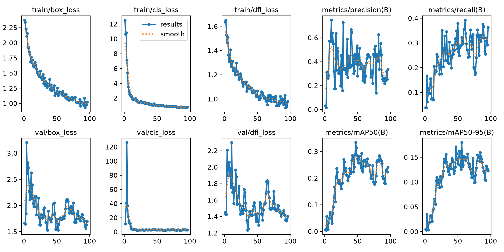
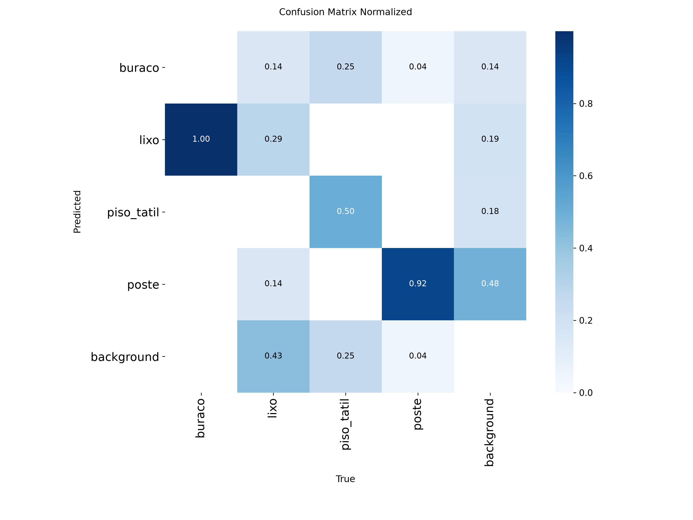
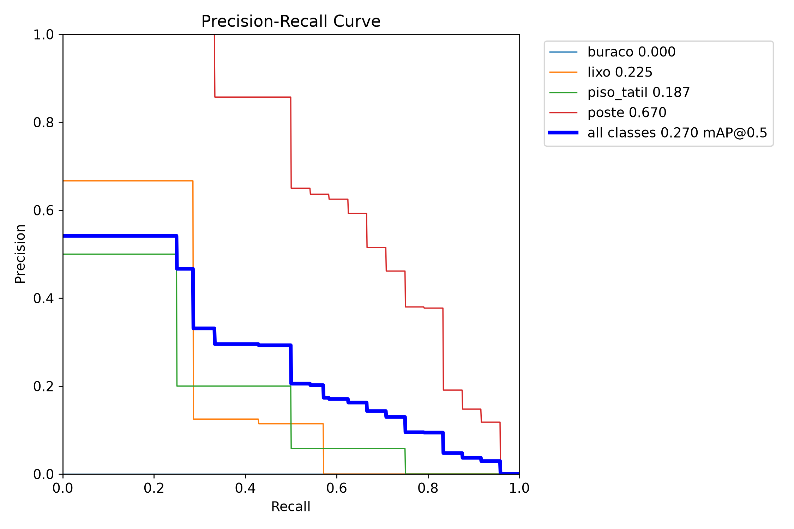
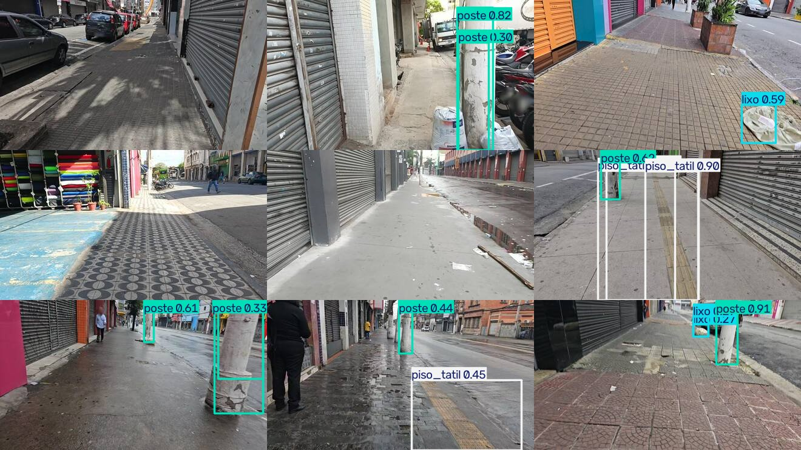

# 🚶 Auditoria de Calçadas com YOLOv8n — da coleta ao celular

**Checkpoint CPZÃO (CP2 + CP3) · Visão Computacional**

Pipeline completo de visão computacional para **auditar calçadas**: coleta das fotos reais da
[Auditoria Cidadã de Calçadas do Brás](https://falzoni.com.br/auditoriacalcadas/), curadoria e rotulagem,
treinamento de um **YOLOv8n**, análise de métricas, exportação para **ONNX** e inferência **em tempo real no celular**
(câmera traseira) com o [`yoloinferApp`](https://github.com/Mjrovai/yoloinferApp) adaptado.

> 📱 **App no celular:** **https://autierii.github.io/auditoria-calcadas-yolo/**
> (abra no navegador do celular → toque em **📷 Câmera** → permita o acesso à câmera)

## 👥 Integrantes

| Nome | RM |
| --- | --- |
| Rafael Autieri | RM550885 |
| Rafael Mattos | RM99874 |
| Levy Nascimento | RM98655 |
| Luiza Cristina | RM99367 |

---

## 1. O problema

Calçadas ruins (buracos, peças soltas), obstáculos (postes no meio do passeio), lixo acumulado e a falta ou
descontinuidade do piso tátil tornam a cidade inacessível, sobretudo para pessoas com deficiência visual,
cadeirantes e idosos. A auditoria cidadã do Brás percorreu **65 km de calçadas** e gerou milhares de fotos, mas
analisar tudo isso à mão é caro. A proposta aqui é um detector leve que roda **no próprio celular de quem audita**,
apontando na hora os elementos relevantes.

## 2. Classes escolhidas

| id | classe | o que conta | por que importa na auditoria |
| :-: | --- | --- | --- |
| 0 | `buraco` | buraco ou falha relevante no pavimento: peças faltando, afundamento, remendo quebrado | risco de queda; principal defeito de superfície do relatório |
| 1 | `lixo` | sacos, montes de lixo, entulho e objetos descartados no passeio | obstrução da faixa livre e zeladoria |
| 2 | `piso_tatil` | trecho visível de piso tátil (direcional/alerta, amarelo, ocre, cinza ou azul) | acessibilidade de pessoas com deficiência visual |
| 3 | `poste` | postes de energia, iluminação, placa ou semáforo | principal obstáculo fixo na faixa de circulação |

Os critérios completos de rotulagem estão no cabeçalho de [`data/revisao.txt`](data/revisao.txt).

## 3. Dataset

### 3.1 Coleta

* **Fonte:** fotos de campo da Auditoria Cidadã de Calçadas (Brás/SP, nov/2025, usuário `gabinete_falzoni` no Mapillary).
* O [notebook de apoio da disciplina](https://colab.research.google.com/drive/1WwkI80sm8gJfrYIiCIOiysChPeg1Km_B) baixa
  essas fotos pela API do Mapillary (exige token). O script [`scripts/01_coletar_imagens.py`](scripts/01_coletar_imagens.py)
  é uma adaptação dele com **duas fontes**:
  * `--fonte mapillary`: igual ao notebook (token em `MAPILLARY_TOKEN`);
  * `--fonte falzoni` (padrão): usa a camada *Fotos Auditoria* do [mapa público do projeto](https://falzoni.com.br/auditoria_calcadas/mapa/),
    que referencia **as mesmas fotos (mesmos IDs do Mapillary)**, sem precisar de token.
* Das **5.850** fotos disponíveis foi sorteada uma amostra aleatória de **500** (semente 42); as imagens têm **440×248 px**.

### 3.2 Rotulagem (pré-anotação + revisão manual)

1. **Pré-anotação zero-shot** com **Grounding DINO** ([`scripts/02_pre_anotar.py`](scripts/02_pre_anotar.py)): um prompt por classe,
   mais filtros geométricos e de cor (piso tátil precisa ter pixels amarelados, poste precisa ser alto e fino, etc.).
2. **Revisão manual imagem a imagem** ([`scripts/03_revisar.py`](scripts/03_revisar.py)): cada imagem é desenhada com as caixas
   numeradas e uma grade de coordenadas. Em cada uma decidimos remover caixas erradas, trocar classes, ajustar caixas ou
   **adicionar as que faltaram**. Todas as decisões ficam registradas em [`data/revisao.txt`](data/revisao.txt) (trilha de auditoria),
   e [`scripts/04_aplicar_revisao.py`](scripts/04_aplicar_revisao.py) gera os rótulos finais em formato YOLO em `data/labels/`.

A revisão foi essencial: o detector zero-shot confundia, por exemplo, **pilares de lojas com postes**, **portas amarelas
com piso tátil** e **tampas de bueiro com buracos**. Esses casos foram corrigidos e muitos viraram **exemplos negativos**.
Só entram no dataset as imagens que passaram pela revisão.

### 3.3 Estatísticas

| | imagens | caixas `buraco` | caixas `lixo` | caixas `piso_tatil` | caixas `poste` |
| --- | :-: | :-: | :-: | :-: | :-: |
| **treino** (70 %) | 116 | 15 | 45 | 17 | 131 |
| **validação** (20 %) | 34 | 4 | 13 | 5 | 32 |
| **teste** (10 %) | 17 | 1 | 7 | 4 | 24 |
| **total** | **167** | **20** | **65** | **26** | **187** |

* **167 imagens rotuladas** (mínimo exigido: 60), sendo 135 com objetos e **32 negativas** (sem nenhuma classe, para ensinar o modelo
  o que **não** é objeto) · **298 caixas** · 4 classes. Uma imagem foi descartada na revisão.
* A divisão é aleatória com semente fixa e garante as 4 classes nos três conjuntos ([`data/split.json`](data/split.json)).
* Tamanho médio das caixas (px, na imagem de 440×248): poste 20×85 (alto e fino), lixo 47×36, buraco 92×42, piso tátil 105×150.
* O desbalanceamento (poste ≫ demais) reflete a realidade das calçadas do Brás: há poste em quase toda foto, mas buracos
  bem caracterizados são raros nesta amostra.

## 4. Treinamento e validação

Notebook: [`notebooks/treinamento_yolo_calcadas.ipynb`](notebooks/treinamento_yolo_calcadas.ipynb) (executado, com todas as saídas).

* **Modelo:** YOLOv8n pré-treinado no COCO (3,2 M parâmetros), *fine-tuning* nas 4 classes.
* **Entrada:** `imgsz=448`, que mantém a resolução original das fotos (440 px de largura).
* **Hiperparâmetros:** até 150 épocas com *early stopping* (`patience=40`), batch 16, aumentação padrão da Ultralytics
  (mosaic, HSV, flip, escala, translação), semente 42.
* **Hardware:** NVIDIA RTX 5060 Ti (CUDA 12.8).

## 5. Resultados

### Validação (34 imagens)

| classe | Precision | Recall | mAP@50 | mAP@50-95 |
| --- | :-: | :-: | :-: | :-: |
| `buraco` | 0.419 | 0.250 | 0.259 | 0.128 |
| `lixo` | 0.498 | 0.381 | 0.301 | 0.152 |
| `piso_tatil` | 0.079 | 0.200 | 0.208 | 0.144 |
| `poste` | 0.538 | 0.562 | 0.442 | 0.274 |
| **TODAS** | 0.383 | 0.348 | 0.302 | 0.175 |

### Teste (17 imagens, nunca vistas no treino nem na escolha do modelo)

| classe | Precision | Recall | mAP@50 | mAP@50-95 |
| --- | :-: | :-: | :-: | :-: |
| `buraco` | 1.000 | 0.000 | 0.000 | 0.000 |
| `lixo` | 0.596 | 0.286 | 0.225 | 0.149 |
| `piso_tatil` | 0.205 | 0.250 | 0.187 | 0.102 |
| `poste` | 0.615 | 0.600 | 0.670 | 0.387 |
| **TODAS** | 0.604 | 0.284 | 0.270 | 0.160 |

<p align="center"></p>

<p align="center">
  
  
</p>

<p align="center"></p>

### Escolha da configuração

Com o mesmo split, comparamos modelo × resolução ([`scripts/05_comparar_modelos.py`](scripts/05_comparar_modelos.py), [`model/comparacao.csv`](model/comparacao.csv)):

| modelo | imgsz | mAP@50 (val) | mAP@50-95 (val) |
| --- | :-: | :-: | :-: |
| **YOLOv8n** | **448** | **0.302** | **0.175** |
| YOLO11n | 640 | 0.252 | 0.175 |
| YOLO11n | 448 | 0.187 | 0.126 |
| YOLOv8n | 640 | 0.183 | 0.127 |

O **YOLOv8n a 448 px** foi o melhor e também é o mais barato no celular (640 px custa ~2× mais e só amplia uma foto de 440 px).

### Análise

* **`poste`** é a classe mais confiável: **mAP@50 = 0,67 no teste** e 92 % dos postes detectados com a classe certa na matriz de confusão.
  É a classe com mais exemplos (187) e com forma bem característica.
* **`piso_tatil`** acerta metade das faixas no teste. A dificuldade é que muitas calçadas do Brás têm **pisos decorativos amarelos/ocre**
  muito parecidos com o tátil nas fotos de 440 px, e a faixa costuma estar desbotada.
* **`lixo`** tem boa precisão (0,60) e recall baixo (0,29): o modelo não inventa lixo, mas perde objetos pequenos e variados (sacos, papel, entulho).
  É uma classe visualmente muito heterogênea.
* **`buraco`**: com só 20 exemplos no total, a classe aprende pouco. O único buraco do conjunto de teste foi classificado como `lixo`
  (o que zera a métrica da classe no teste), e na validação o mAP@50 foi 0,26. Esse é o principal ponto a melhorar.
* Os falsos positivos de `poste` vêm principalmente de **pilares de lojas e batentes**, os mesmos casos que já confundiam o detector zero-shot.
* **Perdas:** box/cls/dfl de treino caem de forma contínua, e as de validação estabilizam por volta da época 40–50. O *early stopping*
  (`patience=40`) interrompeu o treino na época 96 (o pico de mAP@50 na validação foi na época 47), o que mostra que mais épocas
  não ajudariam sem mais dados.
* Os números são de conjuntos pequenos (34 e 17 imagens), então variam bastante com poucas detecções. A comparação val × teste
  (0,30 × 0,27 de mAP@50) indica que **não houve overfitting na escolha do modelo**.

## 6. Exportação para mobile

* Formato **ONNX** (opset 12, entrada estática `[1,3,448,448]`, saída `[1,8,4116]`), que é o formato lido pelo `yoloinferApp`
  via **ONNX Runtime Web** (WASM + SIMD), rodando 100 % no aparelho, sem servidor.
* Arquivos: [`model/calcadas.onnx`](model/calcadas.onnx) (12,7 MB), pesos PyTorch [`model/calcadas_best.pt`](model/calcadas_best.pt)
  e metadados [`model/calcadas.json`](model/calcadas.json) (classes + `imgsz`).
* O notebook valida a exportação comparando as detecções do ONNX Runtime com as do PyTorch na mesma imagem.

## 7. App no celular (yoloinferApp adaptado)

Código em [`app/`](app/), a partir de [Mjrovai/yoloinferApp](https://github.com/Mjrovai/yoloinferApp) (licença em `app/LICENSE-yoloinferApp`).

**O que foi adaptado:**

| Original | Adaptado |
| --- | --- |
| entrada fixa 192×192 | tamanho de entrada lido de `models/calcadas.json` (448), com descoberta automática para ONNX enviados pelo usuário |
| nomes de classe fixos (`box`, `wheel`) | nomes lidos do JSON do modelo |
| cor por instância | **cor fixa por classe** (buraco 🔴, lixo 🟠, piso tátil 🟡, poste 🔵) |
| — | **contador de detecções por classe** no quadro atual (resumo da auditoria) |
| modelos COCO/pose/seg | modelo **Calçadas** como padrão + YOLOv8n COCO original para comparação |
| ONNX Runtime Web 1.18, só WASM com 1 thread | ONNX Runtime Web **1.22** com **WebGPU** (GPU do celular) e fallback automático para **WASM multithread** |
| — | service worker injeta os cabeçalhos COOP/COEP (o GitHub Pages não deixa configurá-los), o que libera o WASM multithread |
| WASM do ONNX Runtime via CDN | WASM servido pelo próprio app (não depende de CDN na hora da demo) |
| — | selo com o acelerador em uso (`WebGPU` / `WASM ×N`) e tempo de inferência por quadro (ms) ao lado do FPS |
| caminhos absolutos | caminhos relativos + workflow de deploy no **GitHub Pages** (HTTPS, exigido para a câmera) |
| interface em inglês | interface em português |

A câmera usa `facingMode: 'environment'` (**câmera traseira**), e o app é um PWA: dá para "Adicionar à tela inicial".

**Desempenho** (tempo de inferência do `calcadas.onnx` 448×448, medido no navegador do desktop, Ryzen 7 7800X3D):

| acelerador | ms / quadro |
| --- | :-: |
| WASM 1 thread (como no app original, ORT 1.18) | ~153 ms |
| WASM 4 threads (ORT 1.22 + COOP/COEP) | ~60 ms |
| **WebGPU (ORT 1.22)** | **~10 ms** |

No celular os tempos são maiores, mas a ordem é a mesma: em aparelhos com WebGPU (Chrome Android recente) a detecção fica
fluida, e nos demais o WASM multithread garante vários quadros por segundo.

### Como rodar

**Opção A — direto no celular (recomendado):** abra **https://autierii.github.io/auditoria-calcadas-yolo/** no Chrome (Android) ou Safari (iOS) e toque em **📷 Câmera**.

**Opção B — localmente, servindo para o celular pela rede Wi-Fi:**

```bash
cd app
npm install
npm run dev      # https://<ip-do-pc>:5173  (certificado autoassinado → aceitar o aviso no celular)
```

**Reproduzir o pipeline de dados e o treino:**

```bash
pip install ultralytics transformers onnx onnxslim onnxruntime pandas requests jupyter
python scripts/01_coletar_imagens.py --n 500 --seed 42 --out data/raw         # coleta
python scripts/02_pre_anotar.py --imgs data/raw/imagens --out data/pre_labels  # pré-anotação (GPU recomendada)
python scripts/04_aplicar_revisao.py --rev data/revisao.txt --out data/labels  # aplica a revisão manual
cd notebooks && jupyter nbconvert --to notebook --execute treinamento_yolo_calcadas.ipynb
```

O notebook já copia `calcadas.onnx` e `calcadas.json` para `app/public/models/`.

## 8. Estrutura do repositório

```
├── app/                         # yoloinferApp adaptado (PWA, ONNX Runtime Web)
│   ├── public/models/           # calcadas.onnx + calcadas.json (+ yolov8n.onnx COCO p/ comparação)
│   └── src/                     # main.js, inference.js, style.css
├── data/
│   ├── raw/imagens/             # 500 fotos amostradas da auditoria (+ fotos.csv com metadados/coordenadas)
│   ├── pre_labels/              # pré-anotação Grounding DINO (antes da revisão)
│   ├── labels/                  # rótulos finais YOLO (após revisão manual)
│   ├── revisao.txt              # registro de todas as correções manuais
│   └── split.json               # divisão treino/val/teste
├── model/                       # calcadas.onnx, calcadas_best.pt, calcadas.json, metricas.json
├── notebooks/treinamento_yolo_calcadas.ipynb
├── scripts/                     # 01 coleta · 02 pré-anotação · 03 revisão visual · 04 aplica revisão
└── docs/                        # figuras usadas neste README
```

## 9. Limitações e próximos passos

* **Mais dados para `buraco` e `piso_tatil`.** O caminho natural é rotular mais fotos das 5.850 disponíveis, priorizando os trechos que o
  relatório da auditoria marcou com problema de superfície, e usar fotos em resolução maior (as do Mapillary vão além de 440 px).
* Separar `bueiro/tampa` como classe própria: hoje tampas e grelhas são exemplos negativos, mas são justamente a confusão mais comum com `buraco`.
* Testar quantização INT8 do ONNX para acelerar ainda mais em celulares sem WebGPU.
* Usar o app em campo para coletar novas fotos (*active learning*): as detecções erradas viram novos exemplos rotulados.

## Créditos

* Dados: [Auditoria Cidadã de Calçadas — Gabinete Nabil Bonduki / falzoni.com.br](https://falzoni.com.br/auditoriacalcadas/) (fotos publicadas no Mapillary).
* App base: [yoloinferApp](https://github.com/Mjrovai/yoloinferApp), de Marcelo Rovai.
* Modelos: [Ultralytics YOLOv8](https://github.com/ultralytics/ultralytics), [Grounding DINO](https://huggingface.co/IDEA-Research/grounding-dino-base) (pré-anotação).
